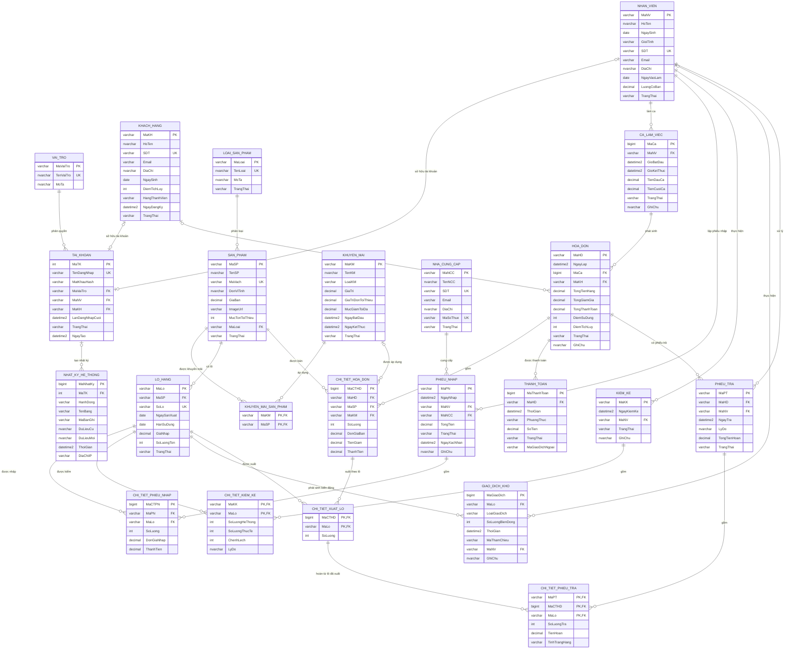

# Entity–Relationship Diagram

Sơ đồ mô tả trạng thái cuối sau khi migration 000–006 được áp dụng; baseline chỉ-init cố ý giữ quan hệ pre-003/pre-004/pre-005/pre-006 để replay migration và không phải schema dùng để vận hành/chấm. Migration 004/005 không thay đổi entity hay relationship; migration 006 chỉ thay đổi database role và quyền.

## Cách đọc cardinality

| Ký hiệu | Ý nghĩa |
|---|---|
| `||` | đúng một |
| `o|` | không hoặc một |
| `o{` | không hoặc nhiều |

Cardinality thể hiện khả năng mà DDL cưỡng chế. Ví dụ, một hóa đơn có thể không gắn khách hàng vì `HOA_DON.MaKH` nullable; một tài khoản có tối đa một chủ sở hữu nhân viên hoặc khách hàng vì có filtered unique index và CHECK độc quyền chủ sở hữu.

## ERD đầy đủ — 23 bảng, 30 FK

## Quan hệ N–N đã được phân rã

| Quan hệ khái niệm | Bảng kết hợp/chi tiết | Khóa |
|---|---|---|
| `KHUYEN_MAI` ↔ `SAN_PHAM` | `KHUYEN_MAI_SAN_PHAM` | `(MaKM, MaSP)` |
| `PHIEU_NHAP` ↔ `LO_HANG` | `CHI_TIET_PHIEU_NHAP` | PK thay thế `MaCTPN`, UQ `(MaPN, MaLo)` |
| `KIEM_KE` ↔ `LO_HANG` | `CHI_TIET_KIEM_KE` | `(MaKK, MaLo)` |
| `CHI_TIET_HOA_DON` ↔ `LO_HANG` | `CHI_TIET_XUAT_LO` | `(MaCTHD, MaLo)` |
| `PHIEU_TRA` ↔ lô đã xuất | `CHI_TIET_PHIEU_TRA` | `(MaPT, MaCTHD, MaLo)` |

## Ghi chú cardinality quan trọng

- `TAI_KHOAN` phải thuộc đúng một trong hai loại chủ sở hữu: nhân viên hoặc khách hàng. `CK_TAI_KHOAN_OwnerExclusive` và `CK_TAI_KHOAN_OwnerRole` cưỡng chế quy tắc này.
- Mỗi nhân viên/khách hàng có tối đa một tài khoản nhờ `UX_TAI_KHOAN_MaNV` và `UX_TAI_KHOAN_MaKH`.
- `HOA_DON.MaKH`, `CHI_TIET_HOA_DON.MaKM`, `GIAO_DICH_KHO.MaNV` và `NHAT_KY_HE_THONG.MaTK` nullable, nên đầu FK tương ứng là tùy chọn.
- FK của `CHI_TIET_PHIEU_TRA` là FK ghép `(MaCTHD, MaLo)` đến `CHI_TIET_XUAT_LO`, bảo đảm chỉ hoàn một lô đã được xuất trên dòng hóa đơn đó.
